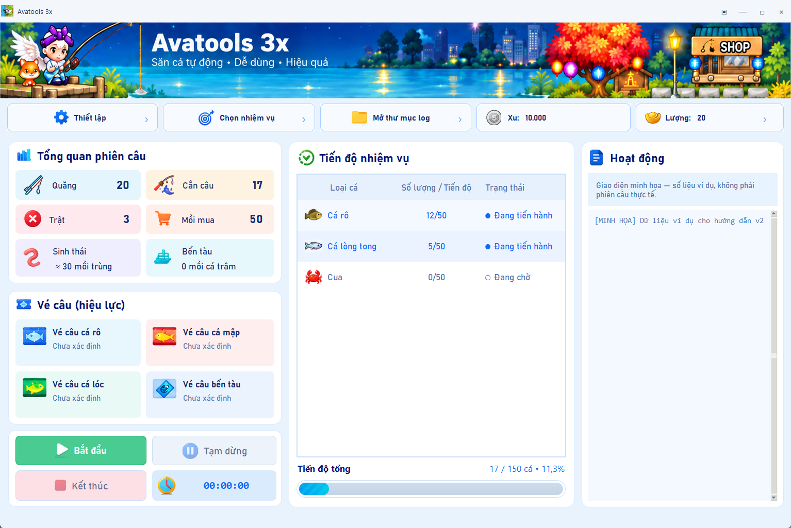
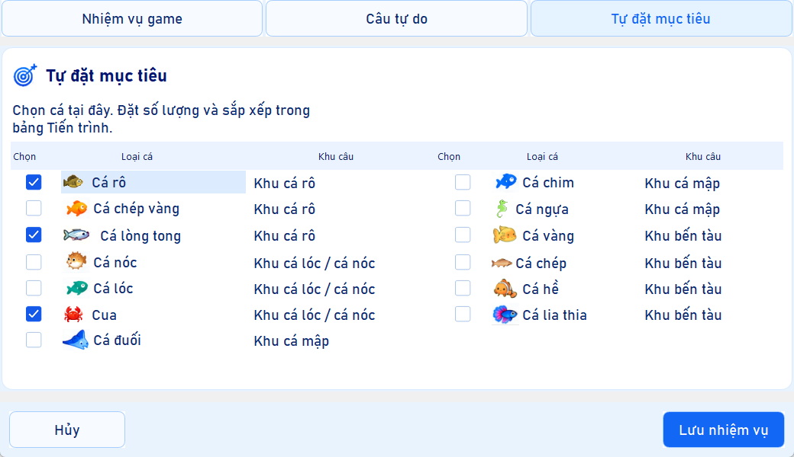
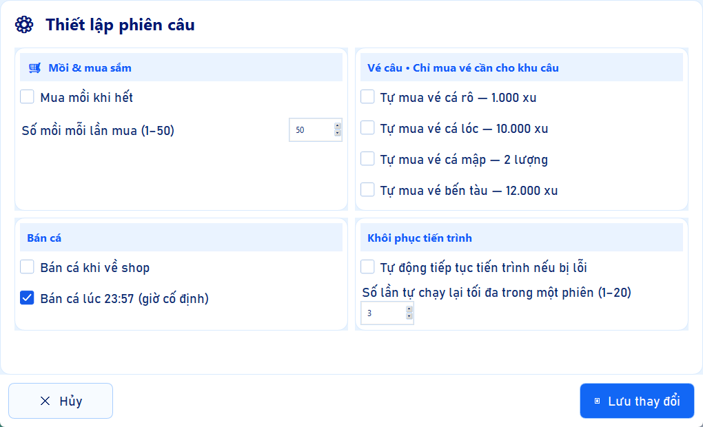

# Avatools 3x — v2.0.0

Tool câu cá tự động cho **Avatar trên LDPlayer**, có giao diện tiếng Việt, theo dõi cá, vé, mồi và nhật ký trong một cửa sổ.

**Chỉ hỗ trợ hoạt động câu cá. Bản Windows không cần cài Python.** Bạn tự đăng nhập game; tool không có ô nhập tài khoản hoặc mật khẩu.

[**Tải Avatools v2.0.0 cho Windows**](https://github.com/caotu-dev/avatar3x-auto-tool/releases/tag/v2.0.0) · [Tất cả phiên bản](https://github.com/caotu-dev/avatar3x-auto-tool/releases) · [Báo lỗi](https://github.com/caotu-dev/avatar3x-auto-tool/issues)



*Ảnh chụp từ ứng dụng thật. Các số liệu, vé và nhật ký trong ảnh là dữ liệu minh họa, không phải kết quả câu thực tế.*

## 1. Chuẩn bị trước khi cài

Bạn cần:

- Máy Windows 10/11 **64-bit**, kết nối Internet và đủ dung lượng để cài LDPlayer/game.
- LDPlayer, game Avatar và tài khoản game của bạn.
- Thư mục có quyền ghi để giải nén tool, ví dụ `D:\Avatools3x`.

Lần đầu chỉ mở **một máy giả lập, một nhân vật và một cửa sổ tool**. Nên chạy thử một phiên ngắn trước khi để máy hoạt động lâu.

## 2. Tải và cài LDPlayer

1. Vào [trang chính thức LDPlayer](https://www.ldplayer.net/), chọn bản cho Windows và tải bộ cài. Tool đã được dùng trên LDPlayer 14; các bản khác cần kiểm tra kết nối ADB và giao diện game trước.
2. Chạy bộ cài, chọn nơi cài và chờ hoàn tất. Mở LDPlayer để khởi tạo Android lần đầu.
3. Nếu LDPlayer yêu cầu bật VT/ảo hóa hoặc không khởi động được, làm theo [hướng dẫn hỗ trợ của LDPlayer](https://www.ldplayer.net/support/).
4. Bấm biểu tượng bánh răng **Cài đặt** của giả lập, thiết lập:

| Mục | Thiết lập |
| --- | --- |
| Độ phân giải bên trong giả lập | **1600 × 900**, màn hình ngang |
| DPI | **240** — cấu hình tham chiếu |
| CPU | Có thể bắt đầu với **4 core** |
| RAM cấp cho giả lập | Thử **2048 MB**; tăng **4096 MB** nếu game tải lại hoặc chạy không ổn |
| FPS | Thử **30–60 FPS** thay vì 120 FPS khi treo máy |
| ADB debugging / Gỡ lỗi ADB | **Open local connection / Mở kết nối cục bộ** |

5. **Lưu** và khởi động lại LDPlayer nếu được yêu cầu.

Tên/vị trí mục cài đặt có thể khác theo phiên bản. ADB thường nằm trong phần **Khác / Other settings**. Tool không yêu cầu bật root hay mở kết nối ADB từ xa. Xem [hướng dẫn ADB chính thức](https://jp.ldplayer.net/support/ldplayer-adb-command.html) nếu không tìm thấy mục này.

**1600 × 900 là độ phân giải Android**, không phải kích thước cửa sổ bạn kéo trên desktop. Giữ giá trị này để tool nhận diện và bấm đúng vị trí.

## 3. Cài game và đăng nhập nhân vật

1. Trong LDPlayer, mở **Google Play / CH Play**, đăng nhập tài khoản Google của bạn nếu được yêu cầu.
2. Tìm **AvatarHD**, nhà phát hành **TeaMobi**. Có thể mở [trang game trên Google Play](https://play.google.com/store/apps/details?id=com.TeaM.Avatar&hl=vi) bằng trình duyệt bên trong LDPlayer, rồi chọn cài đặt. Game cũng có thể được gọi là Avatar / Avatar 2 trong cửa hàng và nội dung giới thiệu.
3. Bấm **Cài đặt**, chờ tải xong rồi **Mở** game.
4. Chờ game tải tài nguyên/cập nhật lần đầu. Chọn phương thức đăng nhập phù hợp với tài khoản đang dùng. Nếu chưa có tài khoản, dùng chức năng đăng ký của game và hoàn thành các bước game yêu cầu.
5. Chọn đúng máy chủ/nhân vật nếu màn hình game yêu cầu, rồi vào thế giới game. Người chơi mới cần hoàn thành hướng dẫn ban đầu và mở được chức năng câu cá.
6. Đóng thông báo sự kiện, quảng cáo, bảng chat, menu người chơi, rương hoặc shop đang che màn hình. Dùng giao diện game **tiếng Việt**, màn hình ngang.
7. Để nhân vật ở màn hình chơi/bản đồ mà bạn điều khiển được. **Tool không đăng nhập tài khoản, vượt màn hình đăng ký hay làm hướng dẫn tân thủ thay bạn.**

Trước lần chạy đầu, kiểm tra nhân vật có thể câu cá ở khu muốn dùng, có mồi và vé cần thiết; hoặc chuẩn bị đủ Xu/Lượng rồi bật tùy chọn tự mua tương ứng ở bước 5. Điều kiện cấp độ và mở khu tuân theo game.

## 4. Tải, giải nén và mở tool

1. Mở [Release v2.0.0](https://github.com/caotu-dev/avatar3x-auto-tool/releases/tag/v2.0.0).
2. Ở phần **Assets**, tải **`Avatools-3x-windows-x64.zip`**. Hai mục **Source code** là mã nguồn, không phải bản chạy sẵn.
3. Nhấp phải ZIP → **Extract All / Giải nén tất cả**. Chọn thư mục như `D:\Avatools3x`.
4. Mở thư mục **Avatools3x** vừa giải nén, chạy **`Avatools 3x.exe`**. Không chạy trực tiếp trong ZIP.
5. Giữ nguyên **toàn bộ file và thư mục đi kèm**. Chép riêng EXE sẽ làm ứng dụng thiếu thư viện hoặc hình ảnh.

Bản portable không cần trình cài đặt hoặc Python. File `SHA256SUMS.txt` trên Release cho phép kiểm tra ZIP đã tải. Bạn có thể kiểm tra trong PowerShell:

```powershell
Get-FileHash '.\Avatools-3x-windows-x64.zip' -Algorithm SHA256
```

So sánh kết quả với dòng tương ứng trong `SHA256SUMS.txt`.

Nếu Windows hiện cảnh báo, hãy kiểm tra đúng nguồn tải GitHub của dự án và tên file trước khi quyết định chạy. Không cần tắt phần mềm bảo vệ để dùng tool.

## 5. Chọn cách câu và thiết lập

LDPlayer phải đang mở game, đã đăng nhập nhân vật và bật ADB trước khi bạn bấm **Bắt đầu**.

### Chọn nhiệm vụ

Bấm **Chọn nhiệm vụ** ở thanh trên cùng, chọn **một** chế độ và lưu:

| Chế độ | Khi nào dùng | Cách chọn |
| --- | --- | --- |
| **Câu tự do** | Câu liên tục ở một khu | Bật câu tự do và chọn khu: cá rô, cá lóc/cá nóc, cá mập hoặc bến tàu. |
| **Nhiệm vụ game** | Làm nhiệm vụ câu cá hiện tại trong game | Bật tự động đọc/làm nhiệm vụ. Khi đủ cá, tool quay lại xác minh, trả nhiệm vụ và đọc nhiệm vụ tiếp theo nếu giao diện được nhận diện. |
| **Tự đặt mục tiêu** | Câu đủ một số lượng cá rồi dừng | Tích các loại cá, chọn hàng, nhập số lượng → **Đặt số lượng**. Dùng ↑/↓ hoặc kéo hàng để đổi thứ tự ưu tiên. |



*Ở chế độ nhiệm vụ game, cần có nhiệm vụ câu cá hợp lệ và các loại cá được hỗ trợ. Nếu không xác nhận được nhiệm vụ mới, tool dừng và báo lý do.*

### Thiết lập phiên câu

Bấm **Thiết lập**, xem các mục sau rồi bấm **Lưu thay đổi**:

| Tùy chọn | Ý nghĩa |
| --- | --- |
| **Mua mồi khi hết** | Cho phép mua thêm mồi khi game xác nhận hết. Tắt tùy chọn này thì tool dừng khi cần mua mồi. |
| **Số mồi mỗi lần mua** | Từ **1 đến 50**. Chỉ tính đã mua khi xác nhận được giao dịch. |
| **Tự mua vé từng khu** | Chọn riêng vé muốn cho phép mua. Các ô này mặc định tắt. Việc mua sử dụng **Xu/Lượng trong game**, kể cả vé cá mập dùng Lượng. |
| **Bán cá khi về shop** | Cho phép bán cá theo luồng shop. |
| **Bán cá lúc 23:57** | Bán theo giờ máy Windows khi tùy chọn bật và đủ điều kiện. |
| **Tự động tiếp tục nếu bị lỗi** | Cho phép thử khôi phục một số lỗi, với giới hạn **1–20 lần/phiên**. Không bảo đảm xử lý được mọi popup hoặc lỗi bộ nhớ. |



Đọc kỹ các tùy chọn mua trước khi lưu. Muốn tự chuẩn bị tài nguyên, mua mồi/vé trong game rồi để các mục tự mua tắt. **Hủy**, nút X hoặc Escape sẽ bỏ thay đổi chưa lưu.

## 6. Chạy phiên đầu tiên

1. Kiểm tra game đã vào màn hình chơi, tool đã chọn chế độ/khu hoặc mục tiêu hợp lệ.
2. Bấm **Bắt đầu** một lần. Tool sẽ điều hướng, kiểm tra rương, vé, mồi và số dư khi cần. Bước chuẩn bị có thể mất thời gian; xem dòng trạng thái và **Hoạt động**.
3. Nếu thiếu tài nguyên, xem thông báo để mua trong game hoặc sửa tùy chọn sau khi kết thúc phiên. Dữ liệu chưa rõ không được coi là đã có vé/mồi.
4. Chờ nhân vật bắt đầu câu. Giữ game mở và không tự bấm/đổi màn hình nhân vật trong khi bot đang điều khiển.
5. Theo dõi số cá và nhật ký. Với mục tiêu tự đặt, tool dừng khi đạt đủ tất cả mục tiêu; câu tự do tiếp tục cho tới khi bạn dừng hoặc gặp điều kiện không thể tiếp tục.

| Điều khiển | Hành vi |
| --- | --- |
| **Tạm dừng** | Chờ lượt hiện tại kết thúc rồi tạm dừng. |
| **Tiếp tục** | Tiếp tục phiên đang tạm dừng. |
| **Kết thúc** | Chặn thao tác mới, chờ thao tác đang thực hiện kết thúc rồi trả về trạng thái dừng. |
| **Nút mini trên thanh tiêu đề** | Thu gọn để theo dõi bảng cá; bấm **Mở rộng** để quay lại. |
| **Mở thư mục log** | Mở vị trí nhật ký để xem hoặc gửi chẩn đoán. |

Muốn đổi nhiệm vụ, khu câu hoặc thiết lập, **Kết thúc phiên trước**. Trước khi đóng LDPlayer, đổi nhân vật hoặc tắt máy, hãy dừng tool và chờ nó kết thúc.

## 7. Đọc các chỉ số trên màn hình

- **Quăng:** số lần quăng trong phiên.
- **Cắn câu:** số lượt thành công đã xác nhận nhận được **một loại cá cụ thể**. Chỉ thấy nút Xong/`RESULT` chưa được tính trúng.
- **Trật:** số lượt quăng trừ số lượt nhận cá cụ thể. Bao gồm kết quả chưa xác nhận nhận cá.
- **Mồi mua:** số mồi mua đã có xác nhận giao dịch.
- **Sinh thái / Bến tàu:** tồn mồi riêng. Dấu **≈** nghĩa là đang ước tính theo lượt câu; **Chưa xác định** nghĩa là chưa có dữ liệu đủ tin cậy.
- **Vé câu:** có/không có/chưa xác định và ngày hết hạn nếu đọc được từ rương.
- **Xu / Lượng:** số dư đọc được; giá trị chưa đọc được hiển thị Chưa xác định.
- **Tiến độ tổng:** tổng cá đạt/tổng yêu cầu, tính theo số lượng từng loài. Cá dư của loài này không bù cho loài khác. Hiệu ứng sọc chỉ là hiển thị.

Tiến độ nhiệm vụ có thể được khôi phục từ dữ liệu đã lưu; các thống kê của một phiên mới không nhất thiết bằng tổng tiến độ nhiệm vụ đã làm trước đó.

## 8. Treo máy và xử lý lỗi

Máy phải còn thức, có mạng và giả lập phải tiếp tục hoạt động. Kiểm tra cài đặt **Sleep / Ngủ** của Windows để máy không tự ngủ giữa phiên. Đừng mở nhiều bản tool cùng điều khiển một nhân vật.

| Hiện tượng | Cách xử lý |
| --- | --- |
| **Bắt đầu bị mờ** | Chọn và lưu một chế độ hợp lệ; câu tự do cần chọn khu, mục tiêu tự đặt cần chọn cá/số lượng. |
| **Không tìm thấy ADB / thiết bị** | Mở LDPlayer, bật ADB cục bộ, khởi động lại giả lập nếu vừa đổi thiết lập. Xem mục ADB bên dưới nếu cài ở ổ khác. |
| **Bấm lệch / không nhận diện** | Kiểm tra độ phân giải Android 1600×900, giao diện tiếng Việt và popup đang che game. |
| **Thiếu vé/mồi hoặc tiền** | Kết thúc phiên, bổ sung tài nguyên trong game hoặc bật đúng tùy chọn tự mua rồi chạy lại. |
| **Game trở về đăng nhập** | Tool có thể xử lý một số màn hình Chơi tiếp đã nhận diện. Nếu yêu cầu nhập tài khoản, đăng nhập thủ công rồi bắt đầu lại. |
| **Popup lạ / shop không được xác nhận** | Tool dừng để tránh bấm sai hoặc mua lặp. Kiểm tra game và log trước khi tiếp tục. |
| **Thiếu DLL / không mở được EXE** | Giải nén lại toàn bộ ZIP vào thư mục có quyền ghi; không tách riêng EXE. |
| **Thiếu bộ nhớ, giả lập lag hoặc màn hình đen** | Dừng tool, đóng hẳn LDPlayer rồi kiểm tra bộ nhớ trong Task Manager. Giảm FPS/tài nguyên giả lập và chạy thử lại một phiên ngắn. Các bản sửa của tool không bảo đảm khắc phục lỗi bộ nhớ trong giả lập/driver. |

Nếu theo dõi RAM, xem cả **Commit size / Kích thước cam kết** trong Task Manager → Details. RAM đặt trong LDPlayer không phải giới hạn tuyệt đối của mọi bộ nhớ mà tiến trình giả lập sử dụng. Giữ pagefile Windows ở chế độ tự quản lý; việc tăng pagefile đơn thuần không chữa được tiến trình tăng bộ nhớ liên tục. Xem [hướng dẫn bộ nhớ của Microsoft](https://learn.microsoft.com/en-us/troubleshoot/windows-server/performance/troubleshoot-application-service-memory-leaks).

### ADB ở ổ khác hoặc nhiều máy giả lập

Tool mặc định dùng `emulator-5554`; tìm ADB trong PATH hoặc `C:\LDPlayer\LDPlayer14\adb.exe`. Nếu không tìm được, mở PowerShell trong thư mục chứa EXE và thay đường dẫn trong ví dụ:

```powershell
$env:AVATAR_ADB_PATH = 'D:\LDPlayer\LDPlayer9\adb.exe'
& $env:AVATAR_ADB_PATH devices
```

Lấy mã ở dòng có trạng thái **device**, rồi mở tool từ cùng cửa sổ:

```powershell
$env:AVATAR_DEVICE_SERIAL = 'emulator-5554'
& '.\Avatools 3x.exe'
```

Các biến này chỉ có hiệu lực với cửa sổ PowerShell đó và ứng dụng mở từ nó. Trạng thái `offline` hoặc không có dòng thiết bị nghĩa là cần sửa kết nối giả lập trước.

### Gửi báo lỗi

Bấm **Mở thư mục log**, lấy log phiên gần nhất trong `debug/ui/` và lỗi liên quan trong `debug/bugs.jsonl` nếu có. Tạo [Issue](https://github.com/caotu-dev/avatar3x-auto-tool/issues) kèm:

- Phiên bản tool, LDPlayer và Windows.
- Chế độ/khu đang câu, việc bạn vừa thực hiện và thời điểm lỗi.
- Log, ảnh lỗi liên quan; với lỗi RAM thêm tên tiến trình và Commit size.

Kiểm tra và che thông tin tài khoản trước khi đăng công khai. Không gửi mật khẩu hoặc mã xác thực.

## 9. Cập nhật và giữ thiết lập

1. Kết thúc phiên và đóng tool cũ.
2. Tải ZIP mới từ Releases và giải nén vào **thư mục mới**.
3. Chép thư mục **`runtime`** từ bản cũ sang cạnh EXE mới để giữ thiết lập và tiến độ tương thích. Giữ thêm **`debug`** nếu cần log cũ.
4. Mở bản mới và kiểm tra lại nhiệm vụ/thiết lập trước khi chạy. Đừng mở đồng thời bản cũ và bản mới cho cùng nhân vật.

`runtime` và `debug` được tạo khi sử dụng; ZIP phát hành không kèm tài khoản, tiến độ hoặc log cá nhân của người phát triển.

## Có gì mới trong v2.0.0?

Giao diện ba cột mới, icon Xu/Lượng nền trong suốt, chế độ mini, sửa giật/viền khi kéo cửa sổ, thống kê nhận cá chính xác hơn và thanh tiến độ cyan có chuyển động. Cải thiện kết nối, xử lý popup, nhật ký và nhánh xử lý thiếu bộ nhớ; vẫn cần game/giả lập hoạt động ổn định.

[Ghi chú phát hành](docs/releases/v2.0.0.md) · [Chạy source, build và tài liệu kỹ thuật](docs/TECHNICAL_GUIDE.md)
