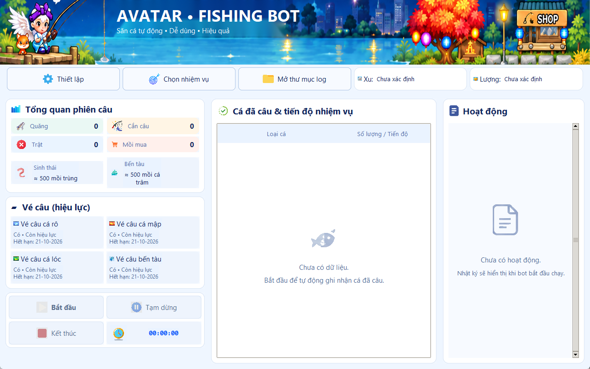
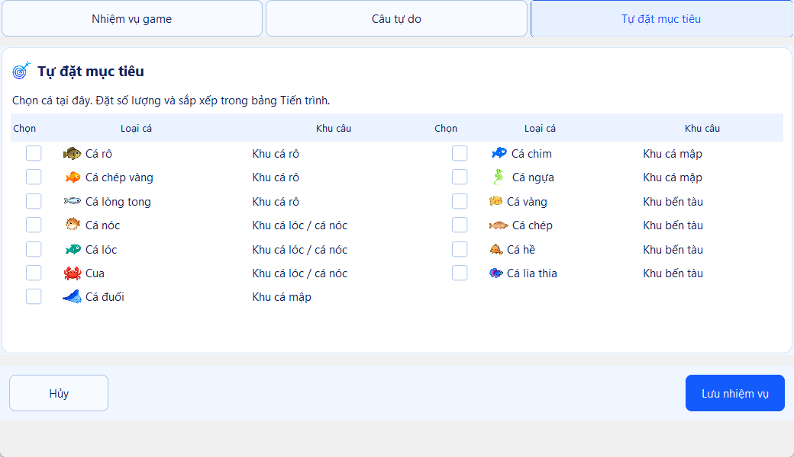
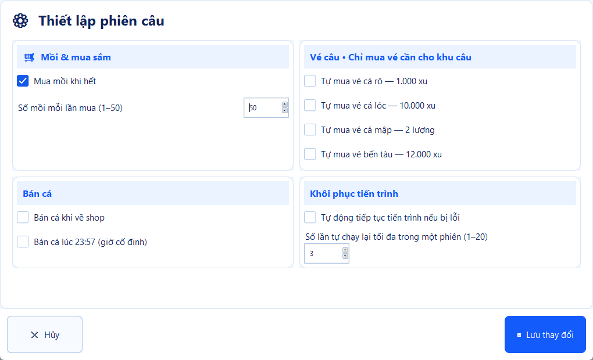

# 🎣 Avatar Fishing Bot

Câu cá tự động trong **Avatar trên LDPlayer**, với giao diện tiếng Việt. Chọn khu câu hoặc đặt mục tiêu, bấm Bắt đầu và theo dõi tiến độ ngay trong ứng dụng.

> **Phạm vi hỗ trợ hiện tại:** Tool chỉ hỗ trợ phần **câu cá**. Các tính năng cho những hoạt động khác trong game sẽ được bổ sung trong tương lai.

**Bản Windows không cần cài Python.** Bạn vẫn cần LDPlayer và game Avatar.

[Tải bản Windows](https://github.com/caotu-dev/avatar3x-auto-tool/releases) · [Tài liệu kỹ thuật](docs/TECHNICAL_GUIDE.md)

> Nếu Releases chưa có bản tải, chủ repo cần phát hành theo hướng dẫn cuối trang. **Code → Download ZIP** chỉ tải mã nguồn.

## Cài và mở lần đầu

1. Vào [Releases](https://github.com/caotu-dev/avatar3x-auto-tool/releases), mở bản muốn dùng, tìm phần **Assets**.
2. Tải **AvatarFishingBot-windows-x64.zip**, không chọn Source code.
3. Nhấp phải ZIP → **Extract All / Giải nén tất cả**, chọn thư mục có quyền ghi, ví dụ `D:\AvatarFishingBot`.
4. Mở thư mục vừa giải nén và chạy **AvatarFishingBot.exe**.

Đây là bản **portable**: giải nén là dùng được, không có bước cài đặt. Giữ nguyên các thư viện cạnh `.exe`; không chép riêng `.exe` hoặc chạy trực tiếp bên trong ZIP.

## Chuẩn bị LDPlayer

1. Mở LDPlayer, cài Avatar và đăng nhập nhân vật.
2. Đặt độ phân giải giả lập **1600 × 900**, chiều ngang. Khởi động lại giả lập nếu được yêu cầu.
3. Bật **ADB debugging / Gỡ lỗi ADB** trong cài đặt LDPlayer. Vị trí mục này tùy phiên bản.
4. Mở game tới màn hình chơi, đóng thông báo đang che màn hình.

Tool mặc định dùng thiết bị `emulator-5554`. Lần đầu nên chỉ mở một máy giả lập.

## Bắt đầu câu

1. Bấm **Chọn nhiệm vụ**, chọn chế độ rồi lưu lựa chọn.
2. Mở **Thiết lập**, xem lượng mồi mua mỗi lần và tùy chọn mua vé/bán cá trước khi lưu. Tự mua vé mặc định tắt; bật mua sẽ dùng Xu/Lượng trong game.
3. Bấm **Bắt đầu**, chờ tool di chuyển và kiểm tra rương, mồi, vé, số dư. Nếu thiếu mồi, bước chuẩn bị có thể mua theo thiết lập.
4. Theo dõi tiến độ và mục **Hoạt động**. Tránh tự thao tác hoặc đổi màn hình game khi bot đang chạy.

| Bạn muốn… | Chế độ | Cách dùng |
|---|---|---|
| Câu ở một khu | **Câu tự do** | Bật chế độ và chọn khu câu. |
| Làm mục tiêu nhiệm vụ | **Nhiệm vụ game** | Bật tự đọc/làm nhiệm vụ; bạn tự trả nhiệm vụ sau khi hoàn thành. |
| Săn số lượng cá cụ thể | **Tự đặt mục tiêu** | Tích cá, chọn hàng, nhập số lượng → **Đặt số lượng**. Dùng ↑/↓ đổi thứ tự. |

**Tạm dừng** có hiệu lực sau lượt hiện tại; **Tiếp tục** giữ phiên. **Kết thúc** ngăn thao tác mới và chờ thao tác đang thực hiện kết thúc. Muốn sửa thiết lập hoặc mục tiêu, kết thúc phiên trước.

## Hình ảnh giao diện

Màn hình chính: tiến độ, mồi, vé và nhật ký phiên câu.



Chọn nhiệm vụ: chọn cách câu phù hợp với bạn.



Thiết lập: điều chỉnh mua mồi, bán cá và các tùy chọn tự động.



Ảnh minh họa có thể khác đôi chút giữa các phiên bản; số liệu trong ảnh chỉ để minh họa.

## Gặp lỗi thì làm gì?

| Hiện tượng | Cách xử lý |
|---|---|
| Không tìm thấy ADB / thiết bị | Kiểm tra LDPlayer đã mở và bật ADB. Nếu cài ở vị trí khác, xem hướng dẫn bên dưới. |
| Bấm lệch / không nhận diện | Kiểm tra độ phân giải bên trong giả lập là **1600 × 900**, đóng popup rồi thử lại. |
| Mồi/vé “Chưa xác định” | Chờ kiểm tra rương hoàn tất. Dấu `≈` ở số mồi là số ước tính trong lúc câu. |
| Thiếu mồi, vé hoặc tiền | Xem nhật ký; bổ sung tài nguyên hoặc xem lại tùy chọn tự mua. |
| Mở app báo thiếu thư viện | Giải nén lại toàn bộ ZIP, giữ các file đi kèm `.exe`. |
| Popup lạ / game thay đổi giao diện | Kết thúc phiên, đóng popup và thử lại; nếu vẫn lỗi, gửi chẩn đoán. |

Bấm **Mở thư mục log**, lấy log và ảnh liên quan trong phiên gần nhất ở `debug/ui/`. Gửi kèm mô tả lỗi, phiên bản tool và LDPlayer tại [Issues](https://github.com/caotu-dev/avatar3x-auto-tool/issues). Kiểm tra ảnh trước khi gửi để tránh lộ thông tin tài khoản.

### LDPlayer ở vị trí khác hoặc nhiều máy giả lập

Tool tìm ADB trong PATH hoặc `C:\LDPlayer\LDPlayer14\adb.exe`. Nếu không tìm được, mở PowerShell tại thư mục ứng dụng. Thay đường dẫn và mã thiết bị trong ví dụ bằng giá trị trên máy bạn:

```powershell
$env:AVATAR_ADB_PATH = 'D:\LDPlayer\LDPlayer9\adb.exe'
& $env:AVATAR_ADB_PATH devices
$env:AVATAR_DEVICE_SERIAL = 'emulator-5554'
.\AvatarFishingBot.exe
```

Lệnh `devices` liệt kê mã thiết bị; chọn dòng có trạng thái `device`. Các biến trên chỉ áp dụng khi mở app từ cửa sổ PowerShell đó.

## Cập nhật và giữ tiến độ

Kết thúc phiên, đóng app. Giải nén bản mới vào thư mục mới, chép **runtime** từ bản cũ sang để giữ thiết lập và tiến độ. Có thể giữ thêm **debug** nếu cần log cũ. Sau đó mở `.exe` của bản mới.

## Dành cho người phát triển / chủ repo

Build trên Windows với Python 3.10 trở lên:

```powershell
python -m venv .venv
.venv\Scripts\python.exe -m pip install -r requirements-build.txt
.venv\Scripts\python.exe gui.py
# Đóng app trước khi build:
powershell -ExecutionPolicy Bypass -File build_gui.ps1
powershell -ExecutionPolicy Bypass -File package_release.ps1
```

ZIP và SHA-256 nằm trong **dist/release/**. Package không kèm cấu hình, tiến độ hay log cá nhân. Máy người dùng vẫn cần ADB của LDPlayer.

### Phát hành bản tải trên GitHub

Đẩy các file này lên repo, vào **Actions → Windows release → Run workflow**. Tải artifact **AvatarFishingBot-windows-x64** để kiểm tra trên máy Windows có LDPlayer.

Để phát hành, tạo và đẩy tag dạng `v1.0.0` ở commit đã kiểm tra. Workflow tạo **draft Release** kèm ZIP và SHA-256. Vào **Releases**, kiểm tra bản nháp, bổ sung ghi chú rồi **Publish release** để người dùng tải được. Mỗi phiên bản dùng tag mới.

Chi tiết dữ liệu lưu trữ, lệnh CLI và kiểm tra nằm trong [tài liệu kỹ thuật](docs/TECHNICAL_GUIDE.md).
